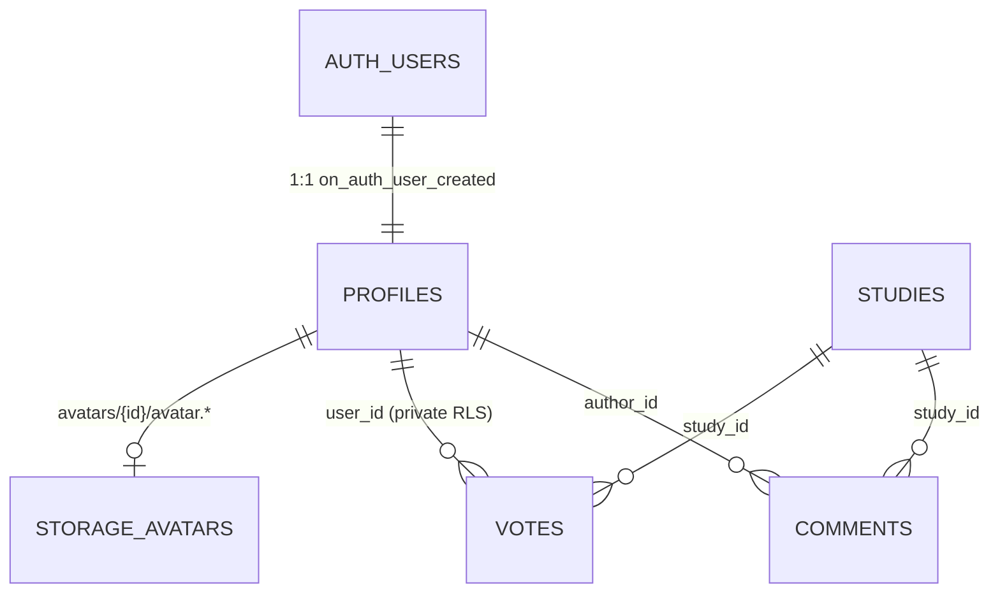

# Data Model: User Profiles, Account Menu Bubble & Public Commenter Views

**Branch**: `003-user-profiles` | **Date**: 2026-11-27 | **Spec**: [spec.md](./spec.md)

## Overview

This feature extends the existing Supabase PostgreSQL + Auth + Storage schema via a single sequential Git-first SQL migration (`supabase/migrations/0008_user_profiles_and_storage.sql`). It introduces domain enums for community role tags and theme preferences, extends `public.profiles`, locks down private profile columns and upvote history at the database privilege/RLS layer, adds keyset-pagination composite indexes on `public.comments` and `public.votes`, and provisions the size- and MIME-restricted `avatars` Supabase Storage bucket.

---

## 1. New Enums & Custom Types

| Type Name | Allowed Values | Purpose |
|-----------|----------------|---------|
| `public.community_role_type` | `'Lifter'`, `'Strength Coach'`, `'Exercise Researcher'`, `'Clinician'`, `'Student'` | Optional domain role tag displayed on `/profile`, `/profile/[id]`, and `/study/[id]` comments (`FR-003`, `FR-009`) |
| `public.theme_preference_type` | `'light'`, `'dark'` | Saved account UI theme preference (`'light'` default per `FR-010` and Constitution Principle III) |

*(Existing `public.user_role` enum `'member' | 'admin'` from `0001_enable_pgvector_and_enums.sql` remains unchanged.)*

---

## 2. Entities & PostgreSQL Schema Definitions

### 2.1 `public.profiles` (Extended User Profile)

Linked `1:1` with `auth.users` via `on_auth_user_created` (`public.handle_new_user()`). Stores both public community identity columns and private account settings, separated at the query boundary via PostgreSQL column-level privileges and an authenticated self-lookup RPC.

| Column | Type | Nullability & Default | Constraints | Visibility Scope |
|--------|------|-----------------------|-------------|------------------|
| `id` | `uuid` | `NOT NULL` | `PRIMARY KEY REFERENCES auth.users(id) ON DELETE CASCADE` | Public (`anon`, `authenticated`) |
| `display_name` | `text` | `NOT NULL` | `CHECK (char_length(btrim(display_name)) BETWEEN 2 AND 50)` | Public (`anon`, `authenticated`) |
| `avatar_url` | `text` | `NULL DEFAULT NULL` | `CHECK (avatar_url IS NULL OR char_length(avatar_url) <= 500)` | Public (`anon`, `authenticated`) |
| `affiliation_role` | `public.community_role_type` | `NULL DEFAULT NULL` | Enum check via type | Public (`anon`, `authenticated`) |
| `bio` | `text` | `NULL DEFAULT NULL` | `CHECK (bio IS NULL OR char_length(bio) <= 160)` | Public (`anon`, `authenticated`) |
| `theme_preference` | `public.theme_preference_type` | `NOT NULL DEFAULT 'light'` | Enum check via type | **Private** (self only via `get_my_account_profile()`; self-updatable) |
| `role` | `public.user_role` | `NOT NULL DEFAULT 'member'` | Protected by `trg_protect_profile_role` | **Private** (self only via `get_my_account_profile()` + `public.is_admin()`) |
| `created_at` | `timestamptz` | `NOT NULL DEFAULT now()` | Immutable creation timestamp | **Private** (self only via `get_my_account_profile()`) |
| `updated_at` | `timestamptz` | `NOT NULL DEFAULT now()` | Updated automatically by `trg_profiles_set_updated_at` | **Private** (self only; self-updatable) |

*(Note: Connected OAuth `email` is never duplicated into `public.profiles`; it remains in `auth.users.email` and is read exclusively from the authenticated user's session via `supabase.auth.getUser()` on `/profile` and in the Account Menu Bubble.)*

#### Validation & Trigger Rules on `public.profiles`
1. **Existing Row Normalization (Pre-Constraint)**: Before adding `profiles_display_name_length_check`, migration `0008` normalizes any existing `display_name` shorter than 2 trimmed characters to `'Lifter'` and truncates any value exceeding 50 characters to `left(btrim(display_name), 50)`.
2. **OAuth Signup Trigger (`public.handle_new_user()`)**:
   - Extracts raw name candidate from `NEW.raw_user_meta_data` (`full_name`, `name`, `user_name`, or email local-part), trims whitespace, truncates to `50` characters, and falls back to `'Lifter'` if `< 2` characters.
   - Leaves `avatar_url = NULL` on initial signup so every new user renders their 2-letter initials badge by default (`FR-001`, Assumption 1).
   - Sets `role = 'member'` and `theme_preference = 'light'`.
   - Uses `ON CONFLICT (id) DO NOTHING` so subsequent auth hooks never overwrite user-customized profile fields.
3. **Role Escalation Guard (`public.protect_profile_role()`)**: Existing `BEFORE UPDATE` trigger prevents any non-`admin` / non-`service_role` caller from modifying `role`.
4. **Timestamp Trigger (`public.set_profiles_updated_at()`)**: Sets `NEW.updated_at = now()` on every `BEFORE UPDATE`.

#### RLS Policies & Column-Level Grants on `public.profiles`
- **RLS Policies**:
  - `profiles_select_public`: `FOR SELECT TO anon, authenticated USING (true)` — enables public `/profile/[id]` lookups and native PostgREST foreign-key joins from `public.comments` without `SECURITY DEFINER` views.
  - `profiles_update_own`: `FOR UPDATE TO authenticated USING ((select auth.uid()) = id) WITH CHECK ((select auth.uid()) = id)` — scopes updates strictly to the owning user.
- **Column-Level Privileges**:
  - `REVOKE SELECT, UPDATE ON TABLE public.profiles FROM anon, authenticated;`
  - `GRANT SELECT (id, display_name, avatar_url, affiliation_role, bio) ON TABLE public.profiles TO anon, authenticated;`
  - `GRANT UPDATE (display_name, avatar_url, affiliation_role, bio, theme_preference, updated_at) ON TABLE public.profiles TO authenticated;`
- **Authenticated Self-Profile RPC (`public.get_my_account_profile()`)**:
  - Signature: `RETURNS TABLE (id uuid, display_name text, avatar_url text, affiliation_role public.community_role_type, bio text, theme_preference public.theme_preference_type, role public.user_role, created_at timestamptz, updated_at timestamptz)`
  - Security: `LANGUAGE sql STABLE SECURITY DEFINER SET search_path = public`, filtering strictly by `WHERE p.id = (select auth.uid())`.
  - Privileges: `REVOKE EXECUTE ON FUNCTION public.get_my_account_profile() FROM PUBLIC, anon; GRANT EXECUTE ON FUNCTION public.get_my_account_profile() TO authenticated, service_role;`

---

### 2.2 `public.votes` (Personal Upvoted Studies Activity & Privacy Hardening)

Existing table `(study_id uuid, user_id uuid, created_at timestamptz, PRIMARY KEY (study_id, user_id))` from `0002_tables_and_indexes.sql`.

- **Privacy Hardening (`FR-008`, `SC-005`)**:
  - Drop `votes_select_public` (`USING (true)`).
  - Create `votes_select_own`: `FOR SELECT TO authenticated USING ((select auth.uid()) = user_id)`.
  - `REVOKE SELECT ON TABLE public.votes FROM anon;` (aggregate counts on `public.studies.upvote_count` remain publicly readable and maintained by `trg_sync_study_upvote_count`).
- **Keyset Pagination Composite Index (`FR-005`)**:
  - `CREATE INDEX IF NOT EXISTS idx_votes_user_history ON public.votes (user_id, created_at DESC, study_id DESC);`
  - Supports $O(1)$ keyset pagination for `/profile` Upvoted Studies (`WHERE user_id = $1 AND (created_at, study_id) < ($cursor_created_at, $cursor_study_id) ORDER BY created_at DESC, study_id DESC LIMIT 21`).

---

### 2.3 `public.comments` (Comment History & Discussion Attribution)

Existing table `(id, study_id, author_id, parent_comment_id, body, is_deleted, created_at, updated_at)` from `0002_tables_and_indexes.sql`.

- **Author Attribution Relationship (`FR-009`)**:
  - `comments.author_id` references `public.profiles(id) ON DELETE CASCADE`.
  - `/study/[id]` discussion queries join `author:profiles!comments_author_id_fkey(id, display_name, avatar_url, affiliation_role)`.
- **Keyset Pagination Partial Composite Index (`FR-005`, `FR-007`)**:
  - `CREATE INDEX IF NOT EXISTS idx_comments_author_history ON public.comments (author_id, created_at DESC, id DESC) WHERE is_deleted = false;`
  - Supports $O(1)$ keyset pagination for both `/profile` (personal comment history) and `/profile/[id]` (public comment history) while automatically excluding soft-deleted comments (`is_deleted = true`) and unpublished studies (via existing `comments_select_public` RLS).

---

### 2.4 Supabase Storage: `avatars` Bucket (`storage.buckets` & `storage.objects`)

Stores compact square user profile thumbnails (`FR-006`, `SC-003`, Constitution Principles I & IV).

| Bucket Property | Value | Rationale |
|-----------------|-------|-----------|
| `id` / `name` | `'avatars'` | Dedicated namespace for user profile photos |
| `public` | `true` | Allows zero-auth CDN/public URL delivery on `/study/[id]` and `/profile/[id]` |
| `file_size_limit` | `512000` (`500 KB`) | Hard server-side cap backing the `<= 200 KB` client-side thumbnail compressor |
| `allowed_mime_types` | `['image/webp', 'image/jpeg', 'image/png']` | Blocks SVG, HTML, PDF, and executable uploads at the Storage API boundary |

#### Object Path Convention
- Canonical object key: `{user_id}/avatar.webp` (or `{user_id}/avatar.jpg` when browser Canvas falls back to JPEG).
- Stored `profiles.avatar_url`: `<SUPABASE_URL>/storage/v1/object/public/avatars/{user_id}/avatar.webp?v=<epoch_ms>`.

#### `storage.objects` RLS Policies
1. `avatars_select_public`: `FOR SELECT TO anon, authenticated USING (bucket_id = 'avatars')`
2. `avatars_insert_own`: `FOR INSERT TO authenticated WITH CHECK (bucket_id = 'avatars' AND (storage.foldername(name))[1] = (select auth.uid())::text)`
3. `avatars_update_own`: `FOR UPDATE TO authenticated USING (bucket_id = 'avatars' AND (storage.foldername(name))[1] = (select auth.uid())::text) WITH CHECK (bucket_id = 'avatars' AND (storage.foldername(name))[1] = (select auth.uid())::text)`
4. `avatars_delete_own`: `FOR DELETE TO authenticated USING (bucket_id = 'avatars' AND (storage.foldername(name))[1] = (select auth.uid())::text)`

---

## 3. Entity Relationships & State Transitions

### Key State Lifecycles

1. **Avatar State**:
   - **Initial Signup**: `avatar_url = NULL` → UI renders deterministic 2-letter uppercase initials from `display_name`.
   - **Upload / Replace**: Client center-crops & downscales raster image (`<= 256x256`, `<= 200 KB`), uploads with `upsert: true` to `avatars/{user_id}/avatar.{ext}`, removes stale alternate extension if present, and updates `profiles.avatar_url` with `?v={timestamp}` → UI renders custom photo everywhere.
   - **Remove Photo**: Client/action deletes `{user_id}/*` objects in `avatars` bucket and sets `profiles.avatar_url = NULL` → UI immediately reverts to 2-letter initials badge.

2. **Theme Preference State (`FR-010`)**:
   - **Unauthenticated / New User**: No `sbl_theme` in `localStorage` → `<html data-theme="light">` (`color-scheme: light`).
   - **Signed-In Toggle (`Light` ↔ `Dark`)**: Updates `document.documentElement.dataset.theme`, `<meta name="color-scheme">`, `localStorage["sbl_theme"]`, and `profiles.theme_preference`.
   - **Sign-Out**: Clears `localStorage["sbl_theme"]` and resets active DOM theme to `light`, while leaving `profiles.theme_preference` untouched in PostgreSQL for restoration on next sign-in.
