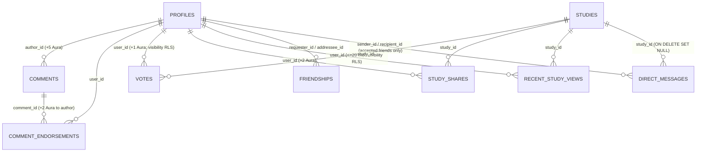
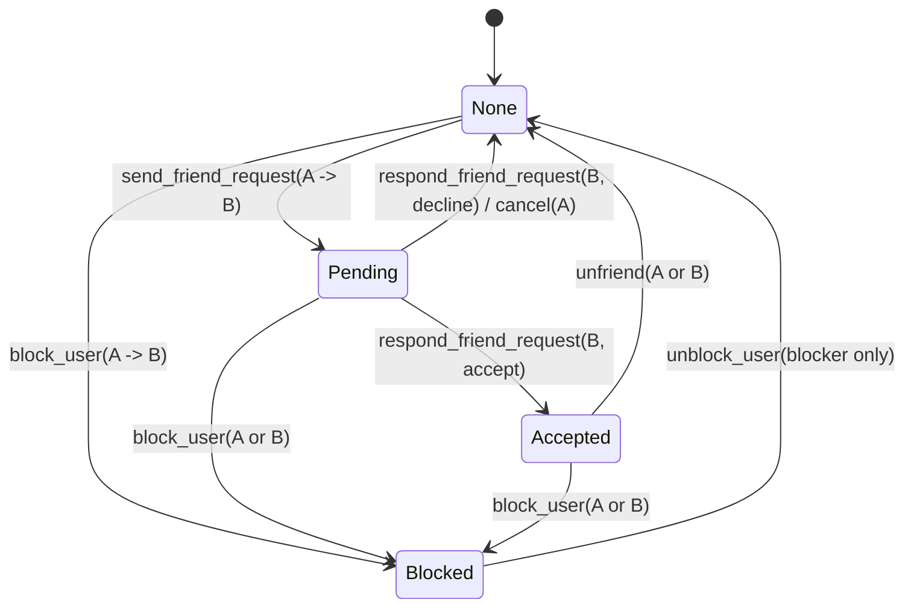

# Data Model: Lightweight Socialization, Aura Leaderboard & Study Sharing

**Branch**: `004-socialization-layer` | **Date**: 2026-11-28 | **Spec**: [spec.md](./spec.md)

## Overview

This feature extends the Supabase PostgreSQL schema via a single sequential Git-first migration (`supabase/migrations/0009_socialization_aura_friends_chat.sql`). It adds deterministic **Aura** columns and three-state activity visibility controls to `public.profiles`, introduces `helpful_count` + `public.comment_endorsements` and `public.study_shares` for verifiable Aura contributions, creates `public.recent_study_views` (capped atomically at 20 studies per opted-in user), and provisions `public.friendships` + `public.direct_messages` with canonical-pair uniqueness, `private` schema RLS helpers, foreign-key indexes, and least-privilege column/RPC grants.

*(Zero new Storage buckets are needed; existing `avatars` bucket from `0008_user_profiles_and_storage.sql` serves all leaderboard, profile, and chat avatars.)*

---

## 1. New Enums & Private Helper Schema

### 1.1 Domain Enums (`public`)

| Type Name | Allowed Values | Purpose |
|-----------|----------------|---------|
| `public.activity_visibility_type` | `'private'`, `'friends'`, `'public'` | Governs who may read a user's Upvoted Studies and Recently Viewed Studies (`'private'` mandatory default per `FR-006`) |
| `public.friendship_status_type` | `'pending'`, `'accepted'`, `'blocked'` | Lifecycle state of a canonical user-pair connection (`FR-010`) |
| `public.share_channel_type` | `'copy_citation'`, `'x'`, `'reddit'`, `'whatsapp'`, `'discord'`, `'web_share'`, `'friend_chat'` | Tracks external and internal study share channels (`FR-001`, `FR-004`) |

### 1.2 Non-Exposed Helper Schema (`private`)

Per Supabase Postgres RLS performance and security best practices, internal relationship/visibility predicates and trigger-driven Aura recomputation live in a non-exposed `private` schema (`REVOKE ALL ON SCHEMA private FROM PUBLIC, anon, authenticated;`):

| Function | Signature & Behavior |
|----------|----------------------|
| `private.are_accepted_friends(p_user_a uuid, p_user_b uuid)` | `RETURNS boolean` (`STABLE SECURITY DEFINER SET search_path = ''`) — indexed $O(1)$ lookup checking `p_user_a IS NOT NULL AND p_user_b IS NOT NULL` and `EXISTS (SELECT 1 FROM public.friendships f WHERE f.user_low_id = LEAST(p_user_a, p_user_b) AND f.user_high_id = GREATEST(p_user_a, p_user_b) AND f.status = 'accepted')`. |
| `private.is_blocked_pair(p_user_a uuid, p_user_b uuid)` | `RETURNS boolean` (`STABLE SECURITY DEFINER SET search_path = ''`) — indexed $O(1)$ lookup checking whether a `'blocked'` row exists between `(LEAST(p_user_a, p_user_b), GREATEST(p_user_a, p_user_b))`. |
| `private.can_view_user_upvotes(p_target_user_id uuid)` | `RETURNS boolean` (`STABLE SECURITY DEFINER SET search_path = ''`) — returns `true` iff `(select auth.uid()) = p_target_user_id`, OR `profiles.upvoted_studies_visibility = 'public'`, OR (`profiles.upvoted_studies_visibility = 'friends'` AND `private.are_accepted_friends((select auth.uid()), p_target_user_id)`). |
| `private.can_view_user_recent_views(p_target_user_id uuid)` | `RETURNS boolean` (`STABLE SECURITY DEFINER SET search_path = ''`) — returns `true` iff `(select auth.uid()) = p_target_user_id`, OR `profiles.viewed_studies_visibility = 'public'`, OR (`profiles.viewed_studies_visibility = 'friends'` AND `private.are_accepted_friends((select auth.uid()), p_target_user_id)`). |
| `private.recompute_user_aura(p_user_id uuid)` | `RETURNS int` (`VOLATILE SECURITY DEFINER SET search_path = ''`) — deterministically recalculates and updates `public.profiles.aura_score` and `aura_updated_at` from underlying valid records subject to UTC daily caps (Section 3). |

---

## 2. Extended & New Tables

### 2.1 `public.profiles` (Extended Columns & Grants)

Adds deterministic **Aura** reputation and three-state activity privacy controls to existing `public.profiles`:

| New Column | Type | Nullability & Default | Constraints | Visibility Scope |
|------------|------|-----------------------|-------------|------------------|
| `aura_score` | `int` | `NOT NULL DEFAULT 0` | `CHECK (aura_score >= 0)` | Public `SELECT` (`anon`, `authenticated`); **NOT** client-updatable |
| `aura_updated_at` | `timestamptz` | `NOT NULL DEFAULT now()` | Updated by `private.recompute_user_aura` | **Internal / Private** (maintained by Aura triggers; not exposed via public `SELECT` or `get_my_account_profile()`) |
| `upvoted_studies_visibility` | `public.activity_visibility_type` | `NOT NULL DEFAULT 'private'` | Enum check | **Private** (`get_my_account_profile()`; owner `UPDATE` granted) |
| `viewed_studies_visibility` | `public.activity_visibility_type` | `NOT NULL DEFAULT 'private'` | Enum check | **Private** (`get_my_account_profile()`; owner `UPDATE` granted) |

#### Updated Indexes & Column-Level Grants on `public.profiles`
- **Leaderboard Index (`FR-002`)**:
  `CREATE INDEX IF NOT EXISTS idx_profiles_aura_leaderboard ON public.profiles (aura_score DESC, display_name ASC, id ASC) WHERE aura_score > 0;`
- **Display-Name Search Index (`FR-010`)**:
  `CREATE INDEX IF NOT EXISTS idx_profiles_display_name_lower ON public.profiles (lower(display_name) text_pattern_ops, aura_score DESC);`
- **Column-Level Grants**:
  - `GRANT SELECT (id, display_name, avatar_url, affiliation_role, bio, aura_score) ON TABLE public.profiles TO anon, authenticated;`
  - `GRANT UPDATE (display_name, avatar_url, affiliation_role, bio, theme_preference, upvoted_studies_visibility, viewed_studies_visibility, updated_at) ON TABLE public.profiles TO authenticated;`
  - Update `public.get_my_account_profile()` return signature to include `aura_score`, `upvoted_studies_visibility`, and `viewed_studies_visibility`.

---

### 2.2 `public.comments` (Extended) & `public.comment_endorsements` (New)

Supports verifiable community endorsements on study comments (`FR-001`, `US2` Scenarios 3 & 5):

- **`public.comments` Extension**:
  - `ADD COLUMN IF NOT EXISTS helpful_count int NOT NULL DEFAULT 0 CHECK (helpful_count >= 0);`
- **`public.comment_endorsements` Table**:

| Column | Type | Nullability & Default | Constraints |
|--------|------|-----------------------|-------------|
| `comment_id` | `uuid` | `NOT NULL` | `REFERENCES public.comments(id) ON DELETE CASCADE` |
| `user_id` | `uuid` | `NOT NULL` | `REFERENCES public.profiles(id) ON DELETE CASCADE` |
| `created_at` | `timestamptz` | `NOT NULL DEFAULT now()` | Creation timestamp (indexed for daily Aura cap) |

- **Primary Key & Indexes**:
  - `PRIMARY KEY (comment_id, user_id)`
  - `CREATE INDEX IF NOT EXISTS idx_comment_endorsements_user_id ON public.comment_endorsements (user_id);`
- **Validation & Sync Triggers**:
  - `BEFORE INSERT` trigger `trg_validate_comment_endorsement`: rejects self-endorsement (`c.author_id = NEW.user_id`), soft-deleted comments (`c.is_deleted = true`), and comments on non-published studies.
  - `AFTER INSERT OR DELETE` trigger `trg_sync_comment_helpful_and_aura`: atomically increments/decrements `public.comments.helpful_count` and calls `private.recompute_user_aura(v_author_id)`.
- **RLS & Grants**:
  - `ALTER TABLE public.comment_endorsements ENABLE ROW LEVEL SECURITY;`
  - `comment_endorsements_select_own`: `FOR SELECT TO authenticated USING ((select auth.uid()) = user_id)` (aggregate counts are read from `public.comments.helpful_count`).
  - `comment_endorsements_insert_own`: `FOR INSERT TO authenticated WITH CHECK ((select auth.uid()) = user_id)`.
  - `comment_endorsements_delete_own`: `FOR DELETE TO authenticated USING ((select auth.uid()) = user_id)`.
  - `GRANT SELECT, INSERT, DELETE ON TABLE public.comment_endorsements TO authenticated;`

---

### 2.3 `public.study_shares` (New — Deduplicated Share Contributions)

Records authenticated study shares for deterministic Aura scoring without inflating storage on repeated clicks (`FR-001`, `FR-004`):

| Column | Type | Nullability & Default | Constraints |
|--------|------|-----------------------|-------------|
| `user_id` | `uuid` | `NOT NULL` | `REFERENCES public.profiles(id) ON DELETE CASCADE` |
| `study_id` | `uuid` | `NOT NULL` | `REFERENCES public.studies(id) ON DELETE CASCADE` |
| `channel` | `public.share_channel_type` | `NOT NULL` | Share target enum |
| `shared_on` | `date` | `NOT NULL DEFAULT (now() AT TIME ZONE 'UTC')::date` | UTC date bucket |
| `created_at` | `timestamptz` | `NOT NULL DEFAULT now()` | First-share timestamp for that UTC day |

- **Primary Key & Indexes**:
  - `PRIMARY KEY (user_id, study_id, shared_on)` — guarantees at most 1 Aura-qualifying share record per user, per study, per UTC day.
  - `CREATE INDEX IF NOT EXISTS idx_study_shares_user_day ON public.study_shares (user_id, shared_on DESC);`
  - `CREATE INDEX IF NOT EXISTS idx_study_shares_study_id ON public.study_shares (study_id);`
- **RLS, Trigger & Grants**:
  - `ALTER TABLE public.study_shares ENABLE ROW LEVEL SECURITY;`
  - `study_shares_select_own`: `FOR SELECT TO authenticated USING ((select auth.uid()) = user_id)`
  - `study_shares_insert_own`: `FOR INSERT TO authenticated WITH CHECK ((select auth.uid()) = user_id AND EXISTS (SELECT 1 FROM public.studies s WHERE s.id = study_id AND s.publication_status = 'published'))`
  - `AFTER INSERT OR DELETE` trigger calls `private.recompute_user_aura(user_id)`.
  - `GRANT SELECT, INSERT ON TABLE public.study_shares TO authenticated;`

---

### 2.4 `public.votes` (Updated Visibility RLS) & `public.recent_study_views` (New)

Enforces opt-in three-state (`private` | `friends` | `public`) profile activity visibility (`FR-006`, `FR-007`, `FR-008`, `SC-004`):

- **`public.votes` RLS Update**:
  - Replace `votes_select_own` with `votes_select_by_visibility`:
    `FOR SELECT TO anon, authenticated USING ((select private.can_view_user_upvotes(user_id)))`
  - `GRANT SELECT ON TABLE public.votes TO anon, authenticated;` *(Default `'private'` still returns 0 rows to `anon` and non-owners, preserving 100% `003-user-profiles` privacy unless the owner explicitly opts in. **Caller Requirement**: Because opted-in users' votes become readable under RLS, all `/web` queries hydrating a viewer's own upvote state MUST explicitly filter `.eq("user_id", user.id)`.)*
  - `AFTER INSERT OR DELETE` Aura trigger calls `private.recompute_user_aura(user_id)` alongside existing `trg_sync_study_upvote_count`.

- **`public.recent_study_views` Table**:

| Column | Type | Nullability & Default | Constraints |
|--------|------|-----------------------|-------------|
| `user_id` | `uuid` | `NOT NULL` | `REFERENCES public.profiles(id) ON DELETE CASCADE` |
| `study_id` | `uuid` | `NOT NULL` | `REFERENCES public.studies(id) ON DELETE CASCADE` |
| `viewed_at` | `timestamptz` | `NOT NULL DEFAULT now()` | Updated on repeat views (`FR-007`) |

- **Primary Key & Indexes**:
  - `PRIMARY KEY (user_id, study_id)` (deduplicates repeated views of the same study).
  - `CREATE INDEX IF NOT EXISTS idx_recent_study_views_user_recent ON public.recent_study_views (user_id, viewed_at DESC, study_id DESC);`
  - `CREATE INDEX IF NOT EXISTS idx_recent_study_views_study_id ON public.recent_study_views (study_id);`
- **RLS & Atomic Recording / Clearing RPCs**:
  - `ALTER TABLE public.recent_study_views ENABLE ROW LEVEL SECURITY;`
  - `recent_study_views_select_by_visibility`: `FOR SELECT TO anon, authenticated USING ((select private.can_view_user_recent_views(user_id)))`
  - `recent_study_views_delete_own`: `FOR DELETE TO authenticated USING ((select auth.uid()) = user_id)` (for **Clear History** on `/profile`).
  - `GRANT SELECT ON TABLE public.recent_study_views TO anon, authenticated;` and `GRANT DELETE ON TABLE public.recent_study_views TO authenticated;` *(Direct `INSERT`/`UPDATE` is withheld; writes execute strictly through `public.record_study_view`.)*
  - `public.record_study_view(p_study_id uuid) RETURNS boolean` (`SECURITY DEFINER SET search_path = public`, granted strictly to `authenticated`):
    1. Resolves `v_user_id := (select auth.uid())`; returns `false` if `NULL`.
    2. Checks caller's `profiles.viewed_studies_visibility IN ('friends', 'public')` and `studies.publication_status = 'published'`; returns `false` without writing if `'private'` (`FR-007`).
    3. Upserts `(v_user_id, p_study_id, now())` on `(user_id, study_id)`.
    4. Atomically deletes any rows for `v_user_id` outside the top 20 `ORDER BY viewed_at DESC, study_id DESC LIMIT 20` (`SC-004`).

---

### 2.5 `public.friendships` (New — Canonical User-Pair Graph)

Manages pending requests, mutual friendships, and directional blocks (`FR-010`, `US4`, `Edge Case 1`):

| Column | Type | Nullability & Default | Constraints |
|--------|------|-----------------------|-------------|
| `id` | `uuid` | `NOT NULL DEFAULT gen_random_uuid()` | `PRIMARY KEY` |
| `requester_id` | `uuid` | `NOT NULL` | `REFERENCES public.profiles(id) ON DELETE CASCADE` |
| `addressee_id` | `uuid` | `NOT NULL` | `REFERENCES public.profiles(id) ON DELETE CASCADE` |
| `user_low_id` | `uuid` | `GENERATED ALWAYS AS (LEAST(requester_id, addressee_id)) STORED` | Canonical pair key 1 |
| `user_high_id` | `uuid` | `GENERATED ALWAYS AS (GREATEST(requester_id, addressee_id)) STORED` | Canonical pair key 2 |
| `status` | `public.friendship_status_type` | `NOT NULL DEFAULT 'pending'` | `'pending' \| 'accepted' \| 'blocked'` |
| `blocked_by_id` | `uuid` | `NULL DEFAULT NULL` | `REFERENCES public.profiles(id) ON DELETE CASCADE` |
| `created_at` | `timestamptz` | `NOT NULL DEFAULT now()` | Creation timestamp |
| `updated_at` | `timestamptz` | `NOT NULL DEFAULT now()` | Updated on status transition |

- **Constraints & Indexes**:
  - `CONSTRAINT friendships_no_self_check CHECK (requester_id <> addressee_id)`
  - `CONSTRAINT friendships_canonical_pair_unique UNIQUE (user_low_id, user_high_id)`
  - `CONSTRAINT friendships_blocked_by_consistency CHECK ((status = 'blocked' AND blocked_by_id IN (requester_id, addressee_id)) OR (status <> 'blocked' AND blocked_by_id IS NULL))`
  - `CREATE INDEX IF NOT EXISTS idx_friendships_requester_status ON public.friendships (requester_id, status, updated_at DESC);`
  - `CREATE INDEX IF NOT EXISTS idx_friendships_addressee_status ON public.friendships (addressee_id, status, updated_at DESC);`
  - `CREATE INDEX IF NOT EXISTS idx_friendships_blocked_by_id ON public.friendships (blocked_by_id) WHERE blocked_by_id IS NOT NULL;`
- **RLS, Grants & State-Transition RPCs**:
  - `ALTER TABLE public.friendships ENABLE ROW LEVEL SECURITY;`
  - `friendships_select_participant`:
    `FOR SELECT TO authenticated USING (((select auth.uid()) IN (requester_id, addressee_id)) AND (status <> 'blocked' OR blocked_by_id = (select auth.uid())))`
    *(Prevents a blocked user from enumerating who blocked them while allowing the blocker to view and unblock.)*
  - `GRANT SELECT ON TABLE public.friendships TO authenticated;` *(Direct `INSERT`/`UPDATE`/`DELETE` is withheld; all friendship mutations execute atomically through the validated `SECURITY DEFINER SET search_path = ''` RPCs below, each granted strictly to `authenticated` except `get_profile_social_context` which is granted to `anon, authenticated`.)*
  - `public.get_profile_social_context(p_target_user_id uuid)` (`STABLE SECURITY DEFINER SET search_path = ''`, granted to `anon, authenticated`) — returns `(can_view_upvotes boolean, can_view_recent_views boolean, friendship_state text, friendship_id uuid)`. Computes visibility via `private.can_view_user_upvotes` / `private.can_view_user_recent_views`; maps `auth.uid() = p_target_user_id` to `'self'`, `auth.uid() IS NULL` or no row to `'none'`, `'accepted'` to `'friends'`, `'pending'` to `'outgoing_pending'`/`'incoming_pending'`, `'blocked'` by caller to `'blocked_by_me'`, and `'blocked'` by target to `'unavailable'` with `friendship_id = NULL`.
  - `public.search_profiles_for_social(p_query text, p_limit int DEFAULT 15)` (`STABLE SECURITY DEFINER SET search_path = ''`, granted to `authenticated`) — searches `public.profiles` using prefix matching `lower(p.display_name) LIKE lower(btrim(p_query)) || '%'` (backed by `idx_profiles_display_name_lower`), excludes `p.id = auth.uid()` and any pair where `private.is_blocked_pair(auth.uid(), p.id)` is true, projects only `TOP_AURA_USER_COLUMNS` + caller's `friendship_state` and `friendship_id`, and caps results at `LEAST(GREATEST(p_limit, 1), 15)`.
  - `public.send_friend_request(p_target_user_id uuid)` (`VOLATILE SECURITY DEFINER SET search_path = ''`, granted to `authenticated`) — rejects self or any blocked pair (`private.is_blocked_pair`), returns `{ friendship_id, state: 'incoming_pending' }` if an incoming pending request already exists from `p_target_user_id` (`Edge Case 1`), returns existing `'accepted'`/`'outgoing_pending'` idempotently, or inserts a new `'pending'` row.
  - `public.respond_friend_request(p_friendship_id uuid, p_decision text)` (`VOLATILE SECURITY DEFINER SET search_path = ''`, granted to `authenticated`) — accepts `'accept'` or `'decline'` strictly when `addressee_id = auth.uid()` and `status = 'pending'`, or `'cancel'` strictly when `requester_id = auth.uid()` and `status = 'pending'`; transitions `'accept'` to `'accepted'` and deletes declined/cancelled rows.
  - `public.remove_or_unblock_friendship(p_target_user_id uuid)` (`VOLATILE SECURITY DEFINER SET search_path = ''`, granted to `authenticated`) — deletes an `'accepted'` row for either participant, or deletes a `'blocked'` row strictly when `blocked_by_id = auth.uid()`.
  - `public.block_user(p_target_user_id uuid)` (`VOLATILE SECURITY DEFINER SET search_path = ''`, granted to `authenticated`) — rejects self, upserts the canonical pair to `status = 'blocked', blocked_by_id = auth.uid()`, and marks any unread incoming `direct_messages` from `p_target_user_id` as read.

---

### 2.6 `public.direct_messages` (New — Friend-Gated 1:1 Chat & Study Cards)

Stores 1:1 plain-text messages and embedded study cards strictly between mutual accepted friends (`FR-011`, `SC-005`, `Edge Cases 2 & 4`):

| Column | Type | Nullability & Default | Constraints |
|--------|------|-----------------------|-------------|
| `id` | `uuid` | `NOT NULL DEFAULT gen_random_uuid()` | `PRIMARY KEY` |
| `sender_id` | `uuid` | `NOT NULL` | `REFERENCES public.profiles(id) ON DELETE CASCADE` |
| `recipient_id` | `uuid` | `NOT NULL` | `REFERENCES public.profiles(id) ON DELETE CASCADE` |
| `pair_low_id` | `uuid` | `GENERATED ALWAYS AS (LEAST(sender_id, recipient_id)) STORED` | Thread partition key 1 |
| `pair_high_id` | `uuid` | `GENERATED ALWAYS AS (GREATEST(sender_id, recipient_id)) STORED` | Thread partition key 2 |
| `body` | `text` | `NULL DEFAULT NULL` | `CHECK (body IS NULL OR (char_length(btrim(body)) >= 1 AND char_length(body) <= 1000))` |
| `study_id` | `uuid` | `NULL DEFAULT NULL` | `REFERENCES public.studies(id) ON DELETE SET NULL` |
| `has_study_attachment` | `boolean` | `NOT NULL DEFAULT false` | Preserves placeholder state if `study_id` is deleted/unpublished |
| `read_at` | `timestamptz` | `NULL DEFAULT NULL` | Null until recipient opens thread |
| `created_at` | `timestamptz` | `NOT NULL DEFAULT now()` | Message timestamp |

- **Constraints & Indexes**:
  - `CONSTRAINT direct_messages_no_self_check CHECK (sender_id <> recipient_id)`
  - `CONSTRAINT direct_messages_content_present_check CHECK (body IS NOT NULL OR has_study_attachment = true)`
  - `CONSTRAINT direct_messages_study_note_length_check CHECK (NOT has_study_attachment OR body IS NULL OR char_length(body) <= 240)`
  - `CREATE INDEX IF NOT EXISTS idx_direct_messages_pair_thread ON public.direct_messages (pair_low_id, pair_high_id, created_at DESC, id DESC);`
  - `CREATE INDEX IF NOT EXISTS idx_direct_messages_recipient_unread ON public.direct_messages (recipient_id, sender_id, created_at DESC) WHERE read_at IS NULL;`
  - `CREATE INDEX IF NOT EXISTS idx_direct_messages_sender_id ON public.direct_messages (sender_id);`
  - `CREATE INDEX IF NOT EXISTS idx_direct_messages_study_id ON public.direct_messages (study_id) WHERE study_id IS NOT NULL;`
- **RLS & Read-Receipt RPC**:
  - `ALTER TABLE public.direct_messages ENABLE ROW LEVEL SECURITY;`
  - `direct_messages_select_participant`:
    `FOR SELECT TO authenticated USING (((select auth.uid()) IN (sender_id, recipient_id)) AND NOT (select private.is_blocked_pair(sender_id, recipient_id)))`
  - `direct_messages_insert_mutual_friends`:
    `FOR INSERT TO authenticated WITH CHECK ((select auth.uid()) = sender_id AND (select private.are_accepted_friends(sender_id, recipient_id)) AND (NOT has_study_attachment OR (study_id IS NOT NULL AND EXISTS (SELECT 1 FROM public.studies s WHERE s.id = study_id AND s.publication_status = 'published'))))`
  - `GRANT SELECT, INSERT ON TABLE public.direct_messages TO authenticated;` *(Direct `UPDATE`/`DELETE` is withheld; read receipts execute strictly via `public.mark_thread_messages_read`.)*
  - `public.mark_thread_messages_read(p_friend_id uuid) RETURNS int` (`SECURITY DEFINER SET search_path = public`, granted to `authenticated`): sets `read_at = now()` where `recipient_id = (select auth.uid()) AND sender_id = p_friend_id AND read_at IS NULL`.

---

## 3. Deterministic Aura Formula Specification (`FR-001`, `SC-003`)

For any user $u$, `private.recompute_user_aura(u)` groups valid contributions by UTC date $d$ (`(created_at AT TIME ZONE 'UTC')::date`) and sums four bounded components:

$$\text{Aura}(u) = \sum_{d} \min(5 \cdot C_{u,d},\, 25) + \sum_{d} \min(2 \cdot E_{u,d},\, 20) + \sum_{d} \min(1 \cdot V_{u,d},\, 10) + \sum_{d} \min(2 \cdot S_{u,d},\, 10)$$

Where on UTC day $d$:
- $C_{u,d}$: Count of `public.comments` by `author_id = u` with `is_deleted = false` on `'published'` studies (`+5` pts, max `25`/day).
- $E_{u,d}$: Count of `public.comment_endorsements` created on day $d$ (`user_id <> u`) targeting non-deleted comments authored by `u` on `'published'` studies (`+2` pts, max `20`/day).
- $V_{u,d}$: Count of `public.votes` by `user_id = u` on `'published'` studies (`+1` pt, max `10`/day).
- $S_{u,d}$: Count of distinct studies in `public.study_shares` by `user_id = u` with `shared_on = d` on `'published'` studies (`+2` pts, max `10`/day).

Deleting a comment (`is_deleted = true` or hard `DELETE`), removing a comment endorsement, or un-upvoting a study immediately triggers `private.recompute_user_aura`, removing those points deterministically (`US2` Scenario 5).

---

## 4. Entity Relationships & Friendship State Machine

