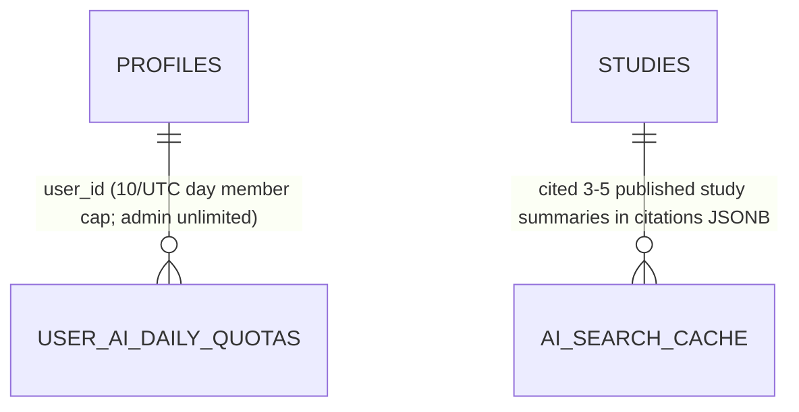
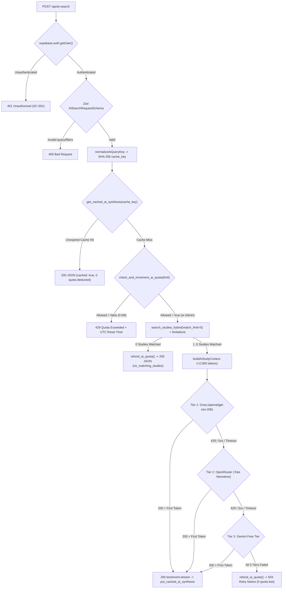

# Data Model: Unified Authenticated AI-Assisted Literature Search

**Branch**: `005-ai-literature-search` | **Date**: 2026-11-28 | **Spec**: [spec.md](./spec.md)

## Overview

This feature extends the Supabase PostgreSQL schema via sequential Git-first migration `supabase/migrations/0011_ai_search_cache_and_quota.sql`. It introduces two compact tables—`public.ai_search_cache` (shared 7/30-day TTL query-answer cache) and `public.user_ai_daily_quotas` (per-user UTC daily synthesis ledger)—protected by Row-Level Security (RLS) and operated strictly through validated `SECURITY DEFINER` RPC functions so browser clients cannot tamper with daily usage counts or poison cached syntheses (Constitution Principle IV, `FR-006`–`FR-008`, `FR-013`).

*(Existing `public.studies` and `public.search_studies_hybrid` from migrations `0002` and `0004` remain the single deterministic retrieval source for top 3–5 published studies.)*

---

## 1. New Tables

### 1.1 `public.ai_search_cache` (Shared Query-Answer Cache)

Stores normalized community training questions paired with their active deterministic filters, synthesized markdown answer, cited study metadata payload (`3–5` published studies), inference tier identifier, and natural TTL expiration timestamp (`FR-006`, `FR-007`, `SC-004`).

| Column | Type | Nullability & Default | Constraints |
|--------|------|-----------------------|-------------|
| `cache_key` | `text` | `NOT NULL` | `PRIMARY KEY`, `CHECK (char_length(cache_key) = 64)` (SHA-256 hex digest of normalized query + filter tuple) |
| `normalized_query` | `text` | `NOT NULL` | `CHECK (char_length(btrim(normalized_query)) >= 3 AND char_length(normalized_query) <= 300)` |
| `filter_signature` | `text` | `NOT NULL` | Canonical filter string (`design=all\|min_weeks=0\|trained=false`) |
| `answer_markdown` | `text` | `NOT NULL` | `CHECK (char_length(btrim(answer_markdown)) >= 1 AND char_length(answer_markdown) <= 8000)` |
| `citations` | `jsonb` | `NOT NULL DEFAULT '[]'::jsonb` | `CHECK (jsonb_typeof(citations) = 'array' AND jsonb_array_length(citations) BETWEEN 1 AND 5)` |
| `tier_used` | `text` | `NOT NULL` | `CHECK (tier_used IN ('groq', 'openrouter', 'gemini'))` |
| `created_at` | `timestamptz` | `NOT NULL DEFAULT now()` | Cache entry creation timestamp |
| `expires_at` | `timestamptz` | `NOT NULL` | `CHECK (expires_at > created_at)` (default `now() + interval '7 days'`, configurable up to `30 days`) |

- **Indexes**:
  - `PRIMARY KEY (cache_key)` — $O(1)$ lookup by canonical SHA-256 key.
  - `CREATE INDEX IF NOT EXISTS idx_ai_search_cache_expires_at ON public.ai_search_cache (expires_at);` — supports opportunistic cleanup of expired rows on write.
- **Row-Level Security & Least-Privilege Grants**:
  - `ALTER TABLE public.ai_search_cache ENABLE ROW LEVEL SECURITY;`
  - `ai_search_cache_select_authenticated`:
    `FOR SELECT TO authenticated USING (expires_at > now());`
  - Direct table `INSERT`, `UPDATE`, and `DELETE` are **withheld** from `anon` and `authenticated` (`REVOKE ALL ON TABLE public.ai_search_cache FROM PUBLIC, anon, authenticated; GRANT SELECT ON TABLE public.ai_search_cache TO authenticated; GRANT ALL ON TABLE public.ai_search_cache TO service_role;`).
  - Reads and writes execute through the server-called `SECURITY DEFINER` RPCs `public.get_cached_ai_synthesis` and `public.put_cached_ai_synthesis` (Section 2).

---

### 1.2 `public.user_ai_daily_quotas` (Per-User UTC Daily Quota Ledger)

Tracks each authenticated user's uncached AI synthesis consumption per UTC calendar day (`FR-008`, `SC-004`).

| Column | Type | Nullability & Default | Constraints |
|--------|------|-----------------------|-------------|
| `user_id` | `uuid` | `NOT NULL` | `REFERENCES public.profiles(id) ON DELETE CASCADE` |
| `usage_date` | `date` | `NOT NULL DEFAULT (now() AT TIME ZONE 'UTC')::date` | UTC calendar date bucket |
| `synthesis_count` | `int` | `NOT NULL DEFAULT 0` | `CHECK (synthesis_count >= 0)` |
| `updated_at` | `timestamptz` | `NOT NULL DEFAULT now()` | Last increment/refund timestamp |

- **Primary Key & Indexes**:
  - `PRIMARY KEY (user_id, usage_date)` — composite primary key starts with `user_id`, covering both `(user_id, usage_date)` atomic upserts and foreign-key cascade deletes on `user_id`.
- **Row-Level Security & Least-Privilege Grants**:
  - `ALTER TABLE public.user_ai_daily_quotas ENABLE ROW LEVEL SECURITY;`
  - `user_ai_daily_quotas_select_own`:
    `FOR SELECT TO authenticated USING ((select auth.uid()) = user_id);`
  - Direct table `INSERT`, `UPDATE`, and `DELETE` are **withheld** from `anon` and `authenticated` (`REVOKE ALL ON TABLE public.user_ai_daily_quotas FROM PUBLIC, anon, authenticated; GRANT SELECT ON TABLE public.user_ai_daily_quotas TO authenticated; GRANT ALL ON TABLE public.user_ai_daily_quotas TO service_role;`).
  - All quota inspections, reservations, and failure refunds execute exclusively through the atomic `SECURITY DEFINER` RPCs below.

---

## 2. Atomic Quota & Shared Cache PostgreSQL RPCs

All RPCs set `SECURITY DEFINER SET search_path = ''`, revoke execution from `PUBLIC` and `anon`, and grant `EXECUTE` strictly to `authenticated` and `service_role`.

### 2.1 `public.get_my_ai_quota_status(p_daily_limit int DEFAULT 10)`

Read-only status lookup used by `/search` (and `GET /api/ai-search`) to display the user's remaining allowance badge (`10/10 LEFT TODAY` or `ADMIN • UNLIMITED`) immediately when **"Ask AI"** is activated (`Clarification 4`, `FR-004`).

- **Returns**: `TABLE (allowed boolean, is_admin boolean, daily_limit int, used_today int, remaining_today int, resets_at_utc timestamptz)`
- **Behavior**:
  1. Resolves `v_user_id := (select auth.uid())`; raises `'Authentication required'` if `v_user_id IS NULL`.
  2. Clamps `v_limit := GREATEST(1, LEAST(COALESCE(p_daily_limit, 10), 100))`.
  3. Computes `v_utc_today := (now() AT TIME ZONE 'UTC')::date` and `v_resets_at := ((v_utc_today + 1)::timestamp AT TIME ZONE 'UTC')`.
  4. Evaluates `v_is_admin := public.is_admin()`.
  5. Reads `COALESCE(q.synthesis_count, 0)` from `public.user_ai_daily_quotas q WHERE q.user_id = v_user_id AND q.usage_date = v_utc_today`.
  6. If `v_is_admin` is `true`, returns `allowed = true, is_admin = true, daily_limit = v_limit, used_today = v_used, remaining_today = v_limit, resets_at_utc = v_resets_at`.
  7. Otherwise returns `allowed = (v_used < v_limit), is_admin = false, daily_limit = v_limit, used_today = v_used, remaining_today = GREATEST(0, v_limit - v_used), resets_at_utc = v_resets_at`.

### 2.2 `public.check_and_increment_ai_quota(p_daily_limit int DEFAULT 10)`

Atomic pre-inference quota reservation executed on shared cache misses (`FR-008`, `SC-004`, `Edge Case 4`, Constitution Principle IV).

- **Returns**: `TABLE (allowed boolean, is_admin boolean, daily_limit int, used_today int, remaining_today int, resets_at_utc timestamptz)`
- **Behavior**:
  1. Resolves `v_user_id := (select auth.uid())`; raises `'Authentication required'` if `v_user_id IS NULL`.
  2. Clamps `v_limit := GREATEST(1, LEAST(COALESCE(p_daily_limit, 10), 100))`, `v_utc_today := (now() AT TIME ZONE 'UTC')::date`, `v_resets_at := ((v_utc_today + 1)::timestamp AT TIME ZONE 'UTC')`.
  3. Checks `v_is_admin := public.is_admin()`.
  4. **Admin Bypass**: If `v_is_admin` is `true`, upserts `(v_user_id, v_utc_today, 1)` for observability without enforcing `v_limit` and returns `allowed = true, is_admin = true, daily_limit = v_limit, used_today = v_new_count, remaining_today = v_limit, resets_at_utc = v_resets_at`.
  5. **Standard Member Atomic Cap**: Executes a single atomic conditional upsert:
     ```sql
     INSERT INTO public.user_ai_daily_quotas (user_id, usage_date, synthesis_count, updated_at)
     VALUES (v_user_id, v_utc_today, 1, now())
     ON CONFLICT (user_id, usage_date) DO UPDATE
       SET synthesis_count = public.user_ai_daily_quotas.synthesis_count + 1,
           updated_at = now()
       WHERE public.user_ai_daily_quotas.synthesis_count < v_limit
     RETURNING synthesis_count INTO v_new_count;
     ```
  6. If `FOUND` (`v_new_count IS NOT NULL`), returns `allowed = true, is_admin = false, daily_limit = v_limit, used_today = v_new_count, remaining_today = GREATEST(0, v_limit - v_new_count), resets_at_utc = v_resets_at`.
  7. If `NOT FOUND` (the user is already at `synthesis_count >= v_limit`), reads current `synthesis_count` and returns `allowed = false, is_admin = false, daily_limit = v_limit, used_today = v_current_count, remaining_today = 0, resets_at_utc = v_resets_at`.

### 2.3 `public.refund_ai_quota(p_daily_limit int DEFAULT 10)`

Atomic compensation RPC invoked by `/api/ai-search` when `search_studies_hybrid` matches `0` published studies (`FR-011`) or when all three AI inference tiers fail/time out before completing a valid synthesis (`FR-013`, `SC-005`).

- **Returns**: `TABLE (allowed boolean, is_admin boolean, daily_limit int, used_today int, remaining_today int, resets_at_utc timestamptz)`
- **Behavior**:
  1. Resolves `v_user_id := (select auth.uid())`; raises `'Authentication required'` if `v_user_id IS NULL`.
  2. Updates `public.user_ai_daily_quotas SET synthesis_count = GREATEST(0, synthesis_count - 1), updated_at = now() WHERE user_id = v_user_id AND usage_date = (now() AT TIME ZONE 'UTC')::date`.
  3. Returns the refreshed `public.get_my_ai_quota_status(p_daily_limit)` row.

### 2.4 `public.get_cached_ai_synthesis(p_cache_key text)`

Looks up an unexpired cached synthesis before quota deduction (`FR-006`, `FR-007`).

- **Returns**: `TABLE (cache_key text, normalized_query text, filter_signature text, answer_markdown text, citations jsonb, tier_used text, created_at timestamptz, expires_at timestamptz)`
- **Behavior**:
  1. Verifies `(select auth.uid()) IS NOT NULL`.
  2. Selects the matching row from `public.ai_search_cache c WHERE c.cache_key = p_cache_key AND c.expires_at > now()`.

### 2.5 `public.put_cached_ai_synthesis(...)`

Stores a newly completed, citation-grounded synthesis in `public.ai_search_cache` and opportunistically prunes expired entries (`FR-007`).

- **Signature**:
  `public.put_cached_ai_synthesis(p_cache_key text, p_normalized_query text, p_filter_signature text, p_answer_markdown text, p_citations jsonb, p_tier_used text, p_ttl_days int DEFAULT 7) RETURNS void`
- **Behavior**:
  1. Verifies `(select auth.uid()) IS NOT NULL`.
  2. Clamps `v_ttl_days := CASE WHEN p_ttl_days = 30 THEN 30 ELSE 7 END` (supporting the `7`- or `30`-day retention policy per Constitution Principle IV and `FR-007`).
  3. Deletes up to 50 expired rows (`DELETE FROM public.ai_search_cache WHERE cache_key IN (SELECT c.cache_key FROM public.ai_search_cache c WHERE c.expires_at <= now() LIMIT 50)`) to keep table footprint bounded on Supabase Free.
  4. Upserts `(p_cache_key, p_normalized_query, p_filter_signature, p_answer_markdown, p_citations, p_tier_used, now(), now() + make_interval(days => v_ttl_days))` into `public.ai_search_cache`.

---

## 3. Egress-Safe Cited Study Context Projection (`FR-009`, `SC-003`)

To assemble `<2,000`-token study contexts and render deterministic evidence + inspection transparency badges alongside methodological limitations (`FR-010`), `/api/ai-search` retrieves the top `3–5` ranked studies from `public.search_studies_hybrid(..., match_limit => 5)` and fetches `limitations` for those `<= 5` study IDs using `AI_CITATION_STUDY_COLUMNS`:

```typescript
export const AI_CITATION_STUDY_COLUMNS = `
  ${STUDY_SUMMARY_COLUMNS},
  limitations
` as const;
```

- **Strictly Excluded Columns**: `abstract_text` and `embedding` (`vector(768)`) are NEVER projected or serialized into `ai_search_cache.citations` or `/api/ai-search` responses (Constitution Principle IV).

### `AiCitationStudy` Structure (Persisted in `ai_search_cache.citations` JSONB)

| Field | Type | Validation / Purpose |
|-------|------|----------------------|
| `citation_label` | `"S1" \| "S2" \| "S3" \| "S4" \| "S5"` | Deterministic inline reference token (`[S1]`..`[S5]`) |
| `id` | `string` (UUID) | Links inline citations and reference cards to `/study/[id]` |
| `title` | `string` | Primary study title |
| `journal` | `string` | Peer-reviewed journal name |
| `publication_year` | `number` | Year of publication |
| `primary_url` | `string` | Direct PubMed / DOI link |
| `study_design` | `StudyDesignType` | Drives deterministic evidence badge (`Meta-Analysis`, `RCT`, etc.) |
| `population` | `string` | Cohort summary |
| `is_trained_population` | `boolean` | Drives `Trained Population` badge (`#FDE68A`) |
| `sample_size_n` | `number \| null` | Monospace `n=...` badge |
| `duration_weeks` | `number \| null` | Monospace `...w` badge |
| `primary_outcome` | `string` | Extracted primary outcome |
| `summary_takeaway` | `string` | 2-sentence objective study takeaway |
| `limitations` | `string[]` | Key methodological limitations surfaced in synthesis & reference cards (`FR-010`) |
| `inspection_depth` | `"Full-Text" \| "Abstract-Only"` | Drives mandatory inspection transparency badge (`#BBF7D0` vs. `#FED7AA`) |
| `quality_score` | `number` | Deterministic Python/SQL evidence score (`0–100`), never altered by LLMs |

---

## 4. Entity Relationships & Request Lifecycle Diagram




